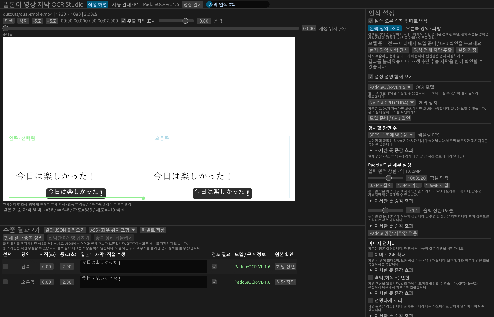

# Japanese Video Subtitle OCR Studio

[](LICENSE)

일본어 영상의 하드코딩 자막을 추출하고, 영상과 함께 검토·수정한 뒤 ASS/SRT/TXT/JSON으로 저장하는 Windows 데스크톱 앱입니다. 번역 없이 일본어 원문을 추출합니다.



## 주요 기능

- MP4 / MKV / MOV 열기, 드래그 앤 드롭, 재생·일시정지·타임라인 탐색·음량 조절
- 영상에서 OCR 영역 드래그 지정, 이동 및 크기 조절
- 전체 영역 하나 또는 왼쪽·오른쪽 두 영역의 독립 OCR 및 시간 계산
- PaddleOCR-VL 1.6 / Manga OCR CPT 모델 선택, 상주 Python 워커 재사용
- NVIDIA CUDA 확인, 실제 추론 장치 표시, CPU fallback 및 작업 취소
- 1 / 2 / 3 / 5FPS 샘플링, PTS 기반 프레임 처리, 모델별 OCR 캐시
- 원본 컬러, 2배 확대, 회색조, 대비 및 선명도 전처리
- 보수적 연속 중복 통합, 직접 선택 병합, 원문 후보 선택 및 직전 병합 되돌리기
- 자막 문구·시간 직접 편집, 추출 자막을 영상 위에 표시
- 하나의 ASS 파일에 좌우 배치 저장, SRT/TXT/JSON 내보내기
- 한국어 설정 설명 및 사용 안내(F1)

**Python 환경, FFmpeg 및 모델 파일이 별도로 필요합니다. Python과 모델까지 포함한 단일 독립 실행 exe가 아닙니다.**

## 개발 환경

우선 지원 환경은 Windows 11 x64 / Rust Stable MSVC입니다. NVIDIA RTX 3060 Ti 8GB에서 CUDA 추론을 확인했습니다. macOS 및 Apple GPU 가속은 아직 구현하지 않았습니다.

1. [Rust](https://rustup.rs/)를 설치하고 `stable-x86_64-pc-windows-msvc`를 사용합니다. `rustup component add rustfmt clippy`로 검사 도구를 설치합니다.
2. Visual Studio C++ Build Tools 또는 Visual Studio Installer에서 **Desktop development with C++**, MSVC x64/x86 도구, Windows SDK를 설치합니다.
3. [Python 3.12 x64](https://www.python.org/downloads/windows/)를 설치합니다. Python은 OCR 추론 워커에만 사용합니다.
4. [FFmpeg](https://ffmpeg.org/download.html)의 `ffmpeg.exe`, `ffprobe.exe`를 PATH에 추가합니다. GUI에서 실행 파일 경로를 직접 지정할 수도 있습니다.
5. CUDA를 사용하려면 호환 NVIDIA 드라이버를 설치하고 `nvidia-smi`를 확인합니다.

```powershell
git clone https://github.com/mmmm-e/japanese-subtitle-ocr.git
cd japanese-subtitle-ocr
```

다음 명령은 프로젝트 루트에서 실행합니다. 설치 후 새 PowerShell에서 `cargo --version`, `python --version`, `ffmpeg -version`, `ffprobe -version`을 확인하세요.

## PaddleOCR-VL 1.6 설치

Paddle용 `.venv-vl`과 Manga OCR용 `.venv`는 Transformers 버전이 달라 분리합니다. 필요한 모델의 환경만 설치해도 됩니다.

```powershell
python -m venv .venv-vl
.\.venv-vl\Scripts\python.exe -m pip install torch==2.11.0 torchvision==0.26.0 --index-url https://download.pytorch.org/whl/cu128
.\.venv-vl\Scripts\python.exe -m pip install -r worker\requirements-vl.txt
```

또는 `scripts/setup-paddle.ps1`을 실행합니다. 스크립트 실행 정책을 자동 변경하지 않으므로 스크립트가 차단되면 위 명령을 직접 실행하세요.

위 CUDA 12.8 wheel은 검증에 사용한 조합입니다. 다른 버전이나 드라이버 환경은 [PyTorch 공식 설치 안내](https://pytorch.org/get-started/locally/) 및 [이전 버전 안내](https://pytorch.org/get-started/previous-versions/)에서 확인하세요. 이 wheel 사용에 CUDA Toolkit 별도 설치는 필요하지 않습니다.

```powershell
.\.venv-vl\Scripts\python.exe -c "import torch; print('PyTorch:', torch.__version__); print('CUDA build:', torch.version.cuda); print('CUDA available:', torch.cuda.is_available()); print('GPU:', torch.cuda.get_device_name(0) if torch.cuda.is_available() else 'CPU')"
```

`nvidia-smi`의 CUDA 표시는 드라이버 지원 상한입니다. CUDA용 PyTorch 설치 여부와 실제 추론 장치를 뜻하지 않으므로 앱의 **모델 준비 / GPU 확인** 결과도 확인하세요. CPU-only PyTorch는 CUDA 지원 상태로 표시하지 않습니다.

## Manga OCR CPT 설치 — 선택 사항

```powershell
python -m venv .venv
.\.venv\Scripts\python.exe -m pip install torch==2.11.0 torchvision==0.26.0 --index-url https://download.pytorch.org/whl/cu128
.\.venv\Scripts\python.exe -m pip install -r worker\requirements.txt
```

또는 `scripts/setup-python.ps1`을 실행합니다. `muscgab/manga-ocr-base-CPT`를 `manga-ocr` 패키지로 불러옵니다. 이 모델은 잘린 한 줄 텍스트 입력을 우선 고려해야 하며 내부적으로 회색조를 사용합니다.

## 빌드 및 실행

```powershell
cargo build --release
.\target\release\japanese-subtitle-ocr.exe
# 또는
.\start.ps1
```

결과물은 `target\release\japanese-subtitle-ocr.exe`입니다. 배포 시 실행 파일뿐 아니라 `worker/`와 사용할 Python 환경도 필요합니다. 폴더를 다른 PC로 옮기면 Python 가상환경을 해당 PC에서 새로 설치하세요.

앱은 실행 파일의 상위 경로에서 `worker/ocr_worker.py`를 찾아 프로젝트 루트를 작업 폴더로 사용합니다. 설정·캐시 저장을 위해 프로젝트 폴더에 쓰기 권한이 필요합니다. `Cargo.lock`은 검증한 Rust 의존성 버전을 고정하기 위해 포함합니다.

## 사용 순서

1. 영상을 열고 재생바로 자막이 보이는 장면을 찾습니다.
2. 일시정지한 뒤 글자가 잘리지 않도록 영역을 드래그합니다. 영역 안쪽은 이동, 우측 하단 손잡이는 크기 조절입니다. 표시 크기를 바꿔도 실제 영상 좌표는 유지됩니다.
3. 오른쪽에서 모델을 선택합니다. 새 설정의 기본 모델은 CPT이므로 Paddle을 사용하려면 **PaddleOCR-VL 1.6**을 직접 선택하세요.
4. **모델 준비 / GPU 확인** 후 **현재 영역 시험 인식**으로 같은 장면에서 결과를 비교합니다.
5. **영상 전체 자막 추출**을 실행합니다. 프레임 준비 중에는 OCR 진행률이 0%일 수 있으며 작업 상태를 확인하세요. GUI는 백그라운드 처리 중에도 응답합니다.
6. 결과의 문구·시간을 직접 편집하고, 재생하면서 추출 자막을 확인합니다. **해당 장면**은 해당 시작 시각으로 이동합니다.
7. 원하는 형식을 골라 저장합니다. 편집 내용은 자동 저장하지 않으며 새 영상이나 다시 추출하기 전에 저장하세요.
8. 모델과 설정을 다음 실행에도 유지하려면 **설정 저장**을 누릅니다.

자세한 설명은 앱의 **사용 안내 · F1** 또는 [한국어 사용설명서](docs/사용설명서.md)를 참고하세요.

### 좌우 자막 두 개를 한 ASS 파일로 저장

**왼쪽·오른쪽 자막 따로 인식**을 켜고 **왼쪽 영역 · 초록**, **오른쪽 영역 · 파랑**을 번갈아 선택해 각각 지정합니다. 시험 인식은 선택한 쪽만, 전체 추출은 양쪽을 순서대로 처리합니다. 프레임과 GPU 모델은 공유하며 동시 추론 수는 1입니다.

두 영역의 시각과 중복 통합은 독립적입니다. 같은 문구가 동시에 양쪽에 나타나도 서로 합치지 않습니다. 미리보기에서도 좌우로 나누어 표시합니다. 저장 형식 **ASS · 좌우 위치 포함**을 선택하면 하나의 파일에 왼쪽 아래·오른쪽 아래로 배치합니다.

ASS는 1920×1080 기준의 x=480/1440, y=1000 위치를 사용하며 재생 크기에 맞춰 조절됩니다. 원본 테롭의 글꼴·색·움직임·정확한 좌표를 복제하지 않습니다. ASS 지원 재생기가 필요합니다. 영역 위치는 설정 파일에 영구 저장하지 않으며 새 영상이나 영역 모드 전환 시 초기화됩니다.

### 속도와 정확도 설정

| 설정 | 높이거나 켰을 때 | 낮추거나 껐을 때 |
| --- | --- | --- |
| 샘플링 FPS | 짧은 자막과 시간 경계를 더 촘촘히 검사, 처리 장수 증가 | 처리 장수 감소, 짧은 자막 누락과 시간 오차 가능 |
| Paddle 입력 면적 상한 | 작은 획을 남길 여지, 메모리·처리 비용 증가 가능 | 처리량 감소 가능, 작은 한자의 획 손실 가능 |
| Paddle 출력 토큰 상한 | 긴 문장 생성에 여유 | 긴 생성 제한, 너무 낮으면 길이 제한 오류 |
| 2배 확대 | 입력 크기 증가, 없는 획을 복원하지는 않음 | 원본 크기 유지 |
| 회색조·대비·선명도 | 장면에 따라 도움 또는 악영향 | 원본 컬러로 비교 가능 |

Paddle은 **1FPS / 입력 약 1.0MP / 출력 512토큰 / 원본 컬러**로 먼저 비교할 수 있습니다. 느리면 같은 장면에서 0.5MP와 비교하세요. 원래 영역이 상한보다 작다면 면적 상한을 내려도 효과가 작을 수 있습니다. 토큰은 글자 조각 단위이며 일본어 글자 수와 1:1이 아닙니다. 상한이 높아도 종료 토큰이 나오면 일찍 멈추므로 상한만 줄인다고 같은 비율로 빨라지지는 않습니다. 종료 토큰 없이 상한에 닿으면 잘린 문구 대신 오류를 반환합니다.

### 중복 정리와 검토

**연속된 같은 자막 통합**은 같은 영역·모델·버전에서 이어지는 결과를 정리합니다. 다른 문구는 시간·짧은 OCR 흔들림·밝은 글자 마스크의 일치 근거가 충분한 경우만 실제 관찰된 원문 후보 중에서 선택합니다. 이미지가 없거나 불확실하면 자동 유사 통합을 생략합니다. 컬러·어두운 글자 전반에 대한 통합 정확도는 검증하지 않았습니다.

**현재 결과 중복 정리**는 기존 결과에도 적용할 수 있습니다. **선택한 행 합치기**로 같은 영역에서 시간상 이어지는 행을 직접 합치고, **통합된 인식 후보**에서 대표 문구를 선택할 수 있습니다. 원문 후보와 근거를 남기며 수정본을 보호합니다. **중복 정리 되돌리기**는 직전 정리 한 번을 취소합니다. 빈 시간 구간은 자동으로 메우지 않습니다.

현재 모델들은 confidence를 제공하지 않으므로 검토 필요 표시는 오류 확정이나 정확도 점수가 아닙니다. 모델 이름 위에 마우스를 올리면 실제 커밋, 최초 추론 시간, 관찰 횟수, 근거 이미지 경로를 확인할 수 있습니다. 폰트가 표시할 수 없는 문자에는 문자 코드 경고가 나옵니다.

### 저장 형식

- **ASS:** 시간과 좌우 위치. 중괄호·역슬래시는 서식 명령으로 해석되지 않도록 전각 문자로 표시하며 원문은 JSON에 남깁니다.
- **SRT:** 시간 포함 자막. 좌우 배치는 보존하지 않습니다.
- **TXT:** 글만 저장합니다.
- **JSON:** 영역·시간·문구·모델·인식 후보·근거 경로. 같은 영상을 열고 **결과 JSON 불러오기**로 재검토할 수 있습니다.

ASS/SRT/TXT 가져오기는 지원하지 않습니다. JSON의 근거 이미지 경로는 로컬 캐시에 의존합니다. 캐시를 삭제하면 이미지 근거를 다시 열 수 없습니다. 저장된 JSON과 로그에는 입력 경로·OCR 문구가 포함될 수 있으므로 공유 전 확인하세요.

## OCR 엔진 구조와 모델 교체

Rust는 GUI·영상·크롭·전처리·캐시·집계·저장을 담당하고, Python은 모델 로딩·추론만 수행합니다. 한 상주 Python 프로세스와 JSON Lines stdin/stdout IPC를 사용합니다. stdout은 구조화된 응답, stderr는 로그 전용입니다.

지원 모델은 `muscgab/manga-ocr-base-CPT`와 `PaddlePaddle/PaddleOCR-VL-1.6`입니다. 모델 선택과 Python 실행 경로는 GUI에서 지정할 수 있습니다. 모델·장치·버전·추론 설정이 바뀌면 다음 요청에서 워커를 다시 준비합니다.

새 모델은 `worker/backends.py`의 어댑터와 등록 정보를 추가하고 워커의 Capability/Recognition 계약 및 모델 선택 정보를 연결합니다. 입력 형태·GPU 지원·동시 추론 수·회색조·여러 줄 지원 여부를 반환합니다. 영상 처리·영역별 집계·ASS/SRT 저장은 공통 인터페이스를 재사용합니다. CPT-flex, PP-OCRv6, Hayai, Qwen3-VL은 미구현이며 지원 모델처럼 표시하지 않습니다.

## 캐시, 취소 및 오류

`.cache/` 안에 영상 메타데이터, PTS 샘플 프레임, 크롭, 모델별 OCR 결과, 최종 세그먼트를 분리합니다. 영상 경로·크기·수정 시각으로 영상 캐시를 구분하고 모델 커밋·전처리·추론 설정을 OCR 캐시에 반영합니다. 모델을 바꿔도 프레임은 재사용하며 중복 통합 설정만 바꾸면 원시 OCR을 다시 계산할 필요가 없습니다. 속도 모드는 내용이 완전히 같은 인접 이미지만 재사용합니다.

모델 다운로드는 Hugging Face 캐시를 사용하며 `HF_HOME`으로 위치를 지정할 수 있습니다. 긴 고해상도 영상의 PNG는 디스크를 많이 사용합니다. 자동 캐시 용량 제한·삭제 UI는 아직 없습니다.

**작업 취소**는 소유한 FFmpeg/Python 프로세스를 종료하고 Windows 가상환경의 자식 프로세스도 회수합니다. 취소 후 모델을 다시 로딩할 수 있습니다. `auto`는 CUDA가 가능하면 GPU, 아니면 CPU로 안내합니다. `cuda`를 명시했는데 사용할 수 없으면 오류를 반환합니다. OOM 발생 시 입력 면적을 줄이거나 다른 GPU 사용량을 줄여 재시도하세요. 8GB에서 모든 입력의 성공을 보장하지 않습니다.

오류 원문은 GUI의 **오류·진단 원문**, OCR 로그는 `.cache/worker.log`, 재생 로그는 `.cache/playback.log`에 있습니다. CPU의 Paddle VL 실제 추론, 장시간 고부하, 다양한 일본어 자막 스타일 전반은 별도 검증이 필요합니다. 샘플링으로 짧은 자막을 놓칠 수 있고 시각 오차도 샘플 간격에 영향을 받습니다. 임의의 한자 교정이나 음성 기반 시간 정렬은 하지 않습니다.

## 검사와 합성 샘플

Mock IPC 검사는 `.venv`의 Python 또는 PATH의 `python`을 사용합니다. GPU 모델을 실행하지 않는 검사에도 FFmpeg/FFprobe가 필요합니다.

```powershell
cargo fmt --check
cargo clippy --all-targets -- -D warnings
cargo test --all-targets
.\.venv-vl\Scripts\python.exe -m unittest discover -s worker -p 'test_*.py'
cargo build --release
```

CUDA 모델 검증은 별도로 실행합니다. 모델 가중치 최초 다운로드에 인터넷 연결이 필요합니다.

```powershell
cargo run --example gpu_smoke -- 'fixtures/일본어 test.mp4' PaddlePaddle/PaddleOCR-VL-1.6
cargo run --example dual_smoke
cargo run --example playback_smoke -- 'fixtures/재생 audio test.mp4'
```

`fixtures/`의 미디어는 글자·시험 패턴·시험음으로 만든 합성 샘플입니다. `dual_smoke`는 좌우에 같은 일본어 문장이 있는 영상을 만들어 CUDA로 인식한 후 `outputs/dual-smoke.ass/.json`에 저장합니다. 공개 스크린샷도 합성 영상으로만 만들었습니다. [검증 범위와 알려진 제한](docs/validation.md)을 참고하세요. 정답 데이터셋의 CER/Exact Match 수치는 아직 없습니다.

설명서의 원본은 `src/guide.rs`입니다. `cargo run --example generate_manual`로 [사용설명서](docs/사용설명서.md)를 갱신할 수 있습니다.

## 공개 파일과 라이선스

개인 설정, 가상환경, 모델, 캐시, 로그, 원본 영상, 추출 결과 및 과거 진단 캡처는 공개 대상에서 제외합니다. 향후 새 파일을 추가할 때도 `git diff --cached`로 경로·내용을 확인하세요. `.gitignore`는 이미 추적된 파일을 자동으로 제거하지 않습니다.

프로젝트 자체 소스 코드는 [MIT License](LICENSE)로 제공합니다. 외부 OCR 모델·라이브러리·FFmpeg는 각각의 라이선스를 따릅니다. [제3자 구성요소 안내](THIRD_PARTY.md)를 참고하세요.
